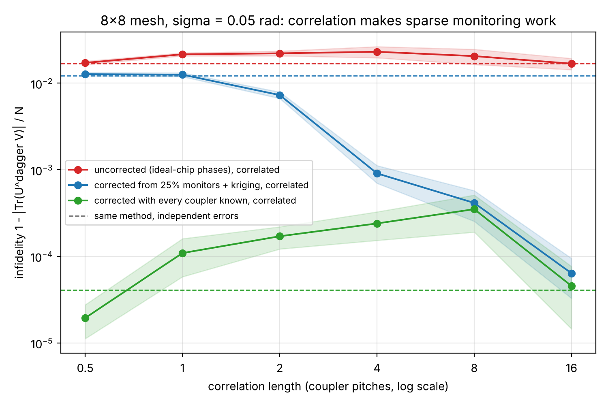
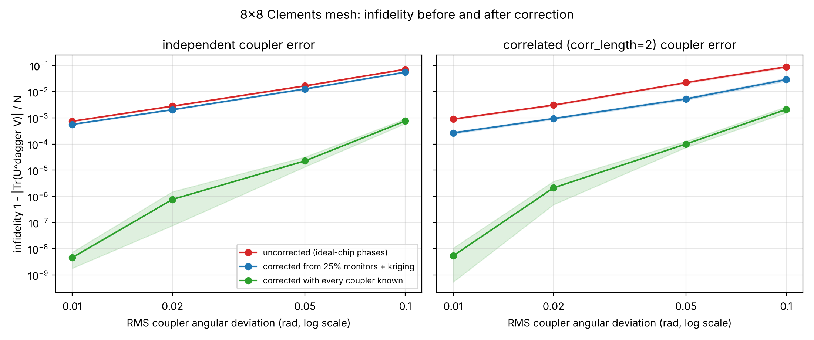
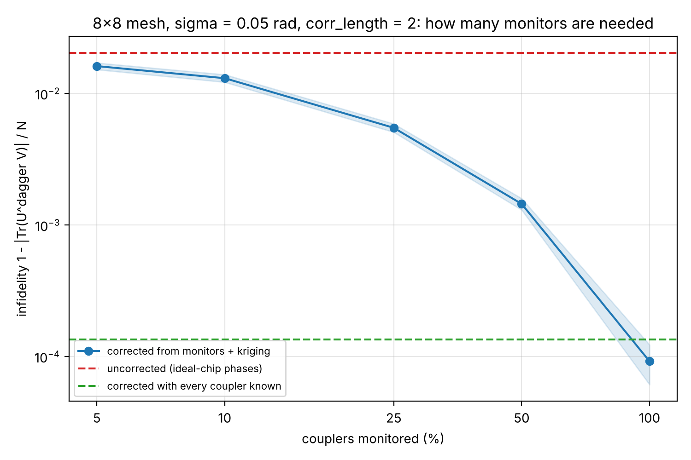

# PROJECT 6: Correcting Correlated Fabrication Error in Photonic Meshes from Sparse Monitors

This project corrects a Clements mesh with coupler errors by re-optimising its phases with a differentiable JAX model. The correction either knows every coupler's error exactly or estimates the errors from a small set of noisy on-chip monitors using Gaussian-process regression (kriging). Comparing the two under independent and correlated errors shows what correlation does to estimation and what it does to correction.



## Features

- **Differentiable Mesh Model**: A JAX implementation of the Clements mesh with coupler errors, checked against the NumPy model to machine precision and compiled once per mesh size
- **Hardware Error Correction**: Every phase is re-optimised with L-BFGS using exact gradients, starting from the phases compiled for an ideal chip
- **Sparse Monitoring**: A fixed fraction of couplers is measured with noise, and kriging estimates the rest from the spatial correlation
- **Fabrication Error Models**: Bandyopadhyay angular-deviation coupler errors, independent or drawn from a Gaussian random field
- **Three Experiments**: Infidelity against coupler error, against correlation length, and against the number of monitors
- **Reproducible**: Seeded random number generators passed explicitly to every sampling function, with results saved as figures and CSV files
- **Tested**: 13 pytest unit tests covering the JAX model, correction, error models and kriging

## Background: Hardware Error Correction

A programmable mesh of MZIs can implement any unitary matrix, which makes it a candidate processor for optical neural networks, quantum photonics and signal processing. Fabrication makes each coupler slightly different from 50:50, so phases compiled for an ideal chip give the wrong matrix, and the error grows with the size of the mesh.

**Hardware error correction** re-solves for the phases using the actual coupler values. Most of the error can be removed this way, because each MZI's phases can partly absorb its couplers' errors, but correction needs to know the errors, and measuring every coupler of a large mesh is slow (as the number of couplers grows as N^2). Fabrication variation is not random from coupler to coupler, as film thickness and waveguide width vary smoothly across a wafer and so nearby couplers have similar errors. This project tests two consequences of that:

- **Estimation should get easier.** If errors are correlated, measuring a few couplers predicts their neighbours, so a sparse set of monitors could replace full characterisation.
- **Correction may get harder.** With coupler errors a1 and a2, an MZI cannot get closer to the cross state than a leakage of sin^2(a1 + a2). Correlation makes the two couplers in one MZI similar, which grows their sum, so some errors stop being correctable by phases alone.

## Installation

1. Install the required dependencies in a virtual environment:
```bash
pip install -r requirements.txt
```

## Usage

Run all three experiments from the repository root:

```bash
python -m src.mesh_error_correction
```

Run a single experiment or change the settings:

```bash
python -m src.mesh_error_correction --experiment sigma
python -m src.mesh_error_correction --experiment corr_length --sigma 0.02 --fraction 0.1 --chips 100
python -m src.mesh_error_correction --experiment monitors --modes 6 --outdir figures --resultsdir results
```

The script will:
1. Compile a JAX model of an 8x8 Clements mesh (28 MZIs, 56 couplers, 64 phases) once
2. For each fabricated chip, draw a Haar-random target unitary and a set of coupler errors from the chosen model
3. Measure the infidelity with the ideal-chip phases (uncorrected), after correcting with every coupler known (exact), and after correcting with errors estimated from 25% of couplers measured with 0.002 rad noise (monitored)
4. Repeat for 40 chips per setting
5. Save figures to `figures/`


## Models

### 1. Coupler Fabrication Error
- A coupler with angular deviation delta splits power as sin^2(pi/4 + delta), so 0.05 rad is about 55:45
- **Independent**: every coupler's error is drawn separately
- **Correlated**: a Gaussian random field with squared-exponential correlation exp(-d^2 / 2 corr_length^2), with corr_length in coupler pitches (the two couplers inside one MZI are 1 pitch apart)

### 2. Correction
- Infidelity is 1 - |Tr(U^dagger V)| / N
- Correction minimises this over all 64 phases with L-BFGS, using gradients from the JAX model, starting from the ideal-chip phases

### 3. Sparse Monitors and Kriging
- A random 25% of coupler sites carry a monitor that measures that coupler's error with 0.002 rad RMS noise
- The other errors are estimated by the Gaussian-process posterior mean: a_hat = K_as (K_ss + sigma_meas^2 I)^-1 y, where K is the error covariance (sigma^2 times the field correlation, or sigma^2 I for independent errors)
- The estimator is given the true sigma and corr_length. Fitting them from the monitor data is a next step

## Results

### Experiment 1: Infidelity vs coupler error (25% of couplers monitored)



| sigma (rad) | Independent: uncorrected | monitored | exact | Correlated (corr_length = 2): uncorrected | monitored | exact |
|---|---|---|---|---|---|---|
| 0.01 | 7.4e-4 | 5.6e-4 | 4.6e-9 | 8.9e-4 | 2.7e-4 | 5.3e-9 |
| 0.02 | 2.8e-3 | 2.0e-3 | 7.6e-7 | 3.1e-3 | 9.4e-4 | 2.1e-6 |
| 0.05 | 1.7e-2 | 1.3e-2 | 2.3e-5 | 2.2e-2 | 5.3e-3 | 1.0e-4 |
| 0.1 | 7.1e-2 | 5.5e-2 | 7.5e-4 | 8.8e-2 | 2.9e-2 | 2.1e-3 |

- **Correction with every coupler known is very powerful**: it cuts the infidelity by 40 to 160,000 times (most at small errors).
- **With independent errors, 25% of monitors remove only 22-27% of the infidelity.** Measuring one coupler says nothing about the others, so the estimate error is 0.85-0.88 sigma, matching the sqrt(0.75) = 0.87 sigma expected when only the measured quarter is known.
- **With correlated errors, the same monitors remove 67-76%**, because kriging predicts the unmeasured couplers from their neighbours (estimate error about 0.5 sigma).
- **Uncorrected, correlated errors are 10-34% more damaging** than independent errors of the same RMS.

### Experiment 2: Infidelity vs correlation length (sigma = 0.05 rad, 25% monitored)

| corr_length (pitches) | Uncorrected | Monitored | Exact | Estimate error / sigma |
|---|---|---|---|---|
| 0.5 | 1.7e-2 | 1.3e-2 | 1.9e-5 | 0.85 |
| 1 | 2.2e-2 | 1.3e-2 | 1.1e-4 | 0.78 |
| 2 | 2.2e-2 | 7.3e-3 | 1.7e-4 | 0.54 |
| 4 | 2.3e-2 | 9.1e-4 | 2.4e-4 | 0.16 |
| 8 | 2.1e-2 | 4.1e-4 | 3.5e-4 | 0.05 |
| 16 | 1.7e-2 | 6.4e-5 | 4.6e-5 | 0.03 |
| independent | 1.7e-2 | 1.2e-2 | 4.1e-5 | 0.83 |

- **Sparse monitoring takes over once the correlation length exceeds the monitor spacing.** The 14 monitors sit about 2.5 pitches apart on average. At a correlation length of 4 pitches they remove 96% of the infidelity, at 8 pitches 98%, and at 16 pitches 99.6%.
- **Correlation raises the floor of exact correction.** For correlation lengths of 1-8 pitches, the residual after exact correction is 1.1-3.5e-4, against 2.3-4.1e-5 for independent errors in Experiments 1 and 2 (roughly 3-15 times higher) and the likely cause is the MZI's cross-state limit. No phase setting gets an MZI closer to cross than sin^2(a1 + a2), and correlation makes a1 and a2 similar, so their sum is larger. The residual comes from a few chips with an MZI pushed past this limit, so it is heavy-tailed (standard errors of 30-70%), and 40 chips do not resolve whether it falls again at 16 pitches.
- **Uncorrected, correlation over 1-8 pitches is 22-38% more damaging** than independent error, and the difference disappears at 0.5 and 16 pitches.

### Experiment 3: How many monitors are needed (sigma = 0.05 rad, corr_length = 2)



| Couplers monitored | 5% | 10% | 25% | 50% | 100% |
|---|---|---|---|---|---|
| Infidelity | 1.6e-2 | 1.3e-2 | 5.5e-3 | 1.4e-3 | 9.2e-5 |
| Fraction of uncorrected infidelity removed | 21% | 36% | 73% | 93% | 99.5% |
| Estimate error / sigma | 0.83 | 0.75 | 0.48 | 0.23 | 0.04 |

- At a correlation length of 2 pitches, about half the couplers must be monitored to remove 90% of the infidelity. At 4 pitches (Experiment 2), a quarter already removes 96%. **The monitor budget is set by the ratio of monitor spacing to correlation length.**
- With every coupler monitored, the 0.002 rad measurement noise costs nothing measurable. The 100% point sits slightly below the exact reference only because the two use different random chips. The difference is within the statistical error.

### What this means for design

Spatial correlation makes fabrication error **far computationally cheaper to measure**, because a quarter of the couplers can stand in for all of them once errors are correlated over a few MZIs. It also makes error **harder to correct with phases alone**, because it pushes the two couplers of an MZI the same way. A practical scheme would combine sparse monitors with kriging for most of the mesh, plus redundant elements where MZIs must work near the cross state.

### Limitations

- Coupler errors only (no phase-shifter error, loss or thermal crosstalk)
- Monitors are idealised as direct, noisy readings of a coupler's error, at a random 25% of sites
- For 8x8 mesh, Haar-random targets and 40 chips per point, the exact-correction residual is heavy-tailed and its values carry large uncertainty with the same setting (sigma = 0.05, corr_length = 2, 25% monitored) in all three experiments with different chips and giving residuals from 5.3e-3 to 7.3e-3
- L-BFGS from the ideal-chip phases finds a local optimum, whilst a global search could lower the exact-correction floor

### Next Steps

- Place monitors deliberately, for example where MZIs work near the cross state, instead of at random
- Add redundant elements only where correction fails
- Scale to 16-64 modes with batched JAX optimisation, and map corr_length to physical wafer-variation length scales

## Example Output

```
=== Correcting Correlated Fabrication Error from Sparse Monitors ===
8x8 Clements mesh | 40 chips per point | monitor noise 0.002 rad

Experiment 1: infidelity vs coupler error (25% of couplers monitored)
  independent done
  correlated (corr_length=2) done

independent
  sigma  uncorrected    monitored        exact  estimate rms / sigma
   0.01     7.38e-04     5.61e-04     4.55e-09                  0.88
   0.02     2.78e-03     2.04e-03     7.64e-07                  0.85
   0.05     1.66e-02     1.26e-02     2.26e-05                  0.85
    0.1     7.11e-02     5.51e-02     7.53e-04                  0.87

correlated (corr_length=2)
  sigma  uncorrected    monitored        exact  estimate rms / sigma
   0.01     8.94e-04     2.66e-04     5.35e-09                  0.55
   0.02     3.05e-03     9.35e-04     2.11e-06                  0.51
   0.05     2.22e-02     5.27e-03     1.00e-04                  0.46
    0.1     8.84e-02     2.88e-02     2.09e-03                  0.52
saved figures/infidelity_vs_sigma.png and results/sigma_sweep.csv

Experiment 2: infidelity vs correlation length (sigma = 0.05 rad, 25% monitored)
  corr_length = 0.5 done
  ...
  corr_length = 16 done

 corr_length  uncorrected    monitored        exact  estimate rms / sigma
         0.5     1.72e-02     1.27e-02     1.94e-05                  0.85
           1     2.15e-02     1.25e-02     1.09e-04                  0.78
           2     2.21e-02     7.29e-03     1.71e-04                  0.54
           4     2.31e-02     9.09e-04     2.40e-04                  0.16
           8     2.05e-02     4.14e-04     3.51e-04                  0.05
          16     1.68e-02     6.38e-05     4.55e-05                  0.03
 independent     1.68e-02     1.22e-02     4.08e-05                  0.83
saved figures/infidelity_vs_corr_length.png and results/corr_length_sweep.csv

Experiment 3: infidelity vs fraction of couplers monitored (sigma = 0.05 rad, corr_length = 2)
  fraction = 0.05 done
  ...
  fraction = 1 done

 monitored   infidelity  estimate rms / sigma
        5%     1.61e-02                  0.83
       10%     1.30e-02                  0.75
       25%     5.47e-03                  0.48
       50%     1.44e-03                  0.23
      100%     9.18e-05                  0.04
      none     2.03e-02   (uncorrected)
     exact     1.34e-04   (every coupler known exactly)
saved figures/infidelity_vs_monitors.png and results/monitor_sweep.csv
```

## Testing

Run the unit tests from the repository root:

```bash
python -m pytest
```

The tests check that:
- The JAX model gives exactly the same matrix as the NumPy `rebuild()`, with coupler errors, and its infidelity matches `fidelity()`
- Every unitary of a given size compiles to the same MZI layout, so one compiled model serves all targets
- An ideal chip needs no correction, and exact correction cuts the infidelity of a fabricated chip by more than 100 times
- Kriging recovers every error when all couplers are monitored, predicts zero for unmeasured independent errors, and predicts a smooth field far better than guessing zero


## Requirements

- Python 3.10+
- NumPy 1.24+
- Matplotlib 3.7+
- SciPy 1.10+
- JAX 0.4.20+
- pytest 8.0+